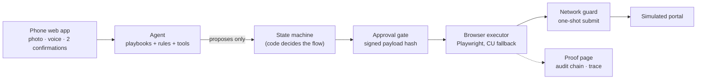

# AppealHero

**Appeal a Boston parking ticket in your own language, with an AI agent whose every step you can check.**

> ⚠️ **Hackathon project** (BostonHacks 2026, Track 3: Boundless Boston).
> All filing happens on a **simulated** portal included in this repo and labeled SIMULATED on every page.
> AppealHero is not affiliated with or endorsed by the City of Boston, and it is not legal advice.
> All demo people, plates and tickets are synthetic.
> **Demo Mode:** single-user demo without accounts. Set `DEMO_KEY` before exposing it through a public tunnel. It is not hardened for multi-user deployment.

## Why

To contest a Boston parking ticket, you have to:
- figure out which rule applies,
- gather evidence,
- write a formal statement in English,
- fill in a web form, all within 21 days.

For residents who are more at home in Chinese or Spanish, that friction can be enough to pay a ticket they could have contested. General-purpose chatbots can draft a letter, but they don't know which Boston rules apply, they can't file anything, and they leave no record you can verify.

## What it does

1. **Identify a ticket.** Upload a photo in the app, or select **Find my ticket** to search the simulated portal by Massachusetts plate or by ticket number. Choose an open ticket to continue.
2. **Asks only what matters.** Each ticket type has a playbook, plus deterministic rules that cite boston.gov. For example, meters are free on Sundays and city holidays, so a Sunday meter ticket needs zero questions.
3. **Review the recommendation.** Each assessment explains the strength of the case, possible objections, and evidence that could help. Drivers can include personal circumstances for a discretionary request. The API also returns available fine, late-fee and deadline information.
4. **Two confirmations.** You confirm the facts first. Then you approve the exact statement, shown in English with your language side by side.
5. **Files it for you.** A browser agent fills in the (simulated) portal, reads the values back, and submits exactly once.
6. **Verifiable afterwards.** The proof page shows the filing timeline and screenshots. The proof API returns the approved form, its fingerprint, the read-back comparison, the confirmation number, the audit-chain head and a downloadable Playwright trace. Open the filing proof from the submitted case to compare fingerprints, inspect screenshots, check status again or download the replay.

| Capability | Status |
|---|---|
| Ticket photo → structured facts (Gemini vision; offline fake mode) | ✅ v0.2 |
| Targeted questions + deterministic Boston rules with official sources | Meter, resident permit and hydrant playbooks implemented and tested offline |
| Honest "pay instead" recommendation | ✅ v0.2 |
| Approval bound to the exact form payload (HMAC-signed) | ✅ v0.2 |
| Browser filing with Playwright | Default T1/T2 verified on the redesigned portal. Live T3 Computer Use did not complete the redesign trial. |
| Read-back gate, one-shot submit interlock, check-status-before-retry | ✅ v0.2 |
| Filing progress and proof | Case timeline, screenshots, confirmation, status recheck and downloadable trace |
| Plate or ticket-number lookup | Read-only API and explicit ticket selection tested against the simulated portal |
| Case strength and personal circumstances | Trilingual strength card, optional circumstances and evidence upload tested in fake mode. [Integration guide](docs/PLAYBOOKS.md#c5-c6-api) |
| Separate fact confirmation and statement approval; statement edits | ✅ v2 (WP0) |
| Chinese / Spanish / English interface | 🆕 v2 |
| Proof API, status check, audit trail and downloadable Playwright trace | Available from the submitted case, including the read-only portal status check. |

## How it works



## What's real and what's simulated

| Real | Simulated |
|---|---|
| Gemini API calls (when a key is set) | The parking-appeal portal (`apps/mock-portal`) |
| Boston rules, fines and deadlines, cited from boston.gov (checked 2026-11-21) | Ticket data (synthetic; ticket numbers start with 9) |
| Browser automation with Playwright | The email receipt (mock inbox) |
| The safety gates and the audit trail | The demo personas |

## Safety by design

1. **The model has no submit, approve or confirm tools**, in any state.
2. **Only the user can confirm facts.** OCR, photo and model-recorded facts all start unconfirmed.
3. **Approval is a signature:** an HMAC over the exact form payload, the adapter version and an expiry. Any change to what will be typed invalidates it.
4. **Read-back gate.** Before submitting, the executor reads the portal's review page back; its values must hash to the approved payload.
5. **Network guard.** Real government hosts are hard-blocked, a single portal origin is allowed, and the submit request can pass exactly once.
6. **An unknown result is never blindly retried.** State changes are written to disk before the click; after a timeout the executor only reads the portal's status page. If the appeal is not there, it pauses and the user decides whether to retry (the portal accepts one appeal per ticket).
7. **Gate 1 cannot be bypassed.** Any new or changed fact after confirmation, including a chat revision, sends the case back to fact confirmation before anything is rewritten.

## Quick start

```bash
# Node >= 20.12 (22 recommended)
npm install
npm run browsers          # Playwright Chromium (or set BROWSER_CHANNEL=chrome to use local Chrome)
cp .env.example .env      # add GEMINI_API_KEY for real Gemini; leave it empty for offline fake mode
npm start                 # app + API on http://localhost:4000, simulated portal on :4100
npm test                  # unit tests + end-to-end portal scenarios (fake AI, simulated portal)
npm run smoke             # with the app running: clicks through the phone flow in a real browser
```

- `npm run dev` runs everything with hot reload, with the web app on http://localhost:5173. Use `npm start` for demos.
- On a phone, the camera and microphone need HTTPS: `cloudflared tunnel --url http://localhost:4000`.

[Demo video, screenshots and cover](docs/demo/) · [Demo script](docs/DEMO.md) · [Devpost draft](docs/DEVPOST.md)

## Local demo integration

- For the weekday meter demo, post the original ticket PNG as multipart `ticket` and the receipt PNG as `images` on the case’s messages endpoint. The fake driver reads the `appealhero:truth` chunk. The sample buttons preserve the original PNG bytes, including the embedded demo data. The app includes both sample buttons.
- For the filing proof, `GET /api/cases/:id/proof` returns the shared `ProofResponseSchema`. A completed recording has a `traceUrl` for a ZIP download. Before read-back, or when an appeal was already on file, the comparison fields can be absent. The proof timeline includes screenshot URLs. `POST /api/cases/:id/status-check` performs a read-only lookup and returns HTTP 409 during a conflicting browser job.
- With a local Gemini key, `npm run smoke:gemini -- --models` lists the available models. With the app running in Gemini mode, `npm run smoke:gemini -- meter` uploads a synthetic ticket and reports the state path, questions, elapsed time and estimated cost when a question or decision is ready. The command also accepts `permit` or `hydrant`. A slow run can take several minutes. To resume polling without uploading or paying for the same ticket again, pass the case ID printed by the command. For a Computer Use trial, restart with `EXEC_TIERS=T1,T3` and select the redesigned simulated portal.

## Verified so far

- On November 22, 2026, 103 tests passed and 29 acceptance tests remained marked `todo`. Formatting, type checking, the state-machine documentation check and the production web build passed.
- In the simulated portal, a session expiry before submission triggers a status check and at most one fresh form. A second expiry pauses the case. An expiry after the submit click triggers read-only reconciliation. Rejected evidence pauses the filing and shows the attachment names and a retry option in all three languages.
- The offline browser checks cover English, Spanish and Chinese on both normal and redesigned portals, at eight viewport sizes. They exercise ticket lookup, evidence, both reviews, filing proof, trace download and draft isolation. The automated suite also covers fact corrections that change the grounds for appeal.
- ✅ v0.2: 21 automated tests and the UI smoke test pass in fake mode. The tests cover a normal filing, the portal-redesign fallback, both timeout reconciliations, CAPTCHA stop, missing-field re-approval, honest triage and the network interlock.
- A live key listed `gemini-3.8-flash`. The model read the three demo ticket photos, transcribed the hydrant voice note and called the Boston rule tools. The Sunday-meter case produced a grounded draft. After both reviews, the simulated portal recorded one appeal, the read-back matched the approved payload and the Playwright trace downloaded. The resident-permit and hydrant cases both closed after the simulated drivers accepted the recommendation to pay. The portal recorded no appeals for those tickets.
- On the redesigned portal, live `gemini-3.8-flash` Computer Use proposed a click and then returned a safety block. A separate field trial with the redesign notice dismissed did not verify the ticket number within three minutes. Both trials stopped before submission. Use the default `EXEC_TIERS=T1,T2` for the demo. The offline end-to-end test verifies that these Playwright tiers fill the redesigned form and submit exactly once.
- A WebKit browser with an emulated iPhone 13 completed the English weekday-meter flow through filing proof. Physical iPhone and Android camera, microphone and permission prompts still need verification.
- 🔲 Real Boston portal: not connected, by design.

## Documentation

| Doc | What's in it |
|---|---|
| [docs/PRODUCT_SPEC.md](docs/PRODUCT_SPEC.md) | Requirements and open decisions (Chinese) |
| [docs/ARCHITECTURE.md](docs/ARCHITECTURE.md) | v2 design: state machine, data model, APIs, agent, executor, proof (Chinese) |
| [docs/PLAYBOOKS.md](docs/PLAYBOOKS.md) | Ticket-type playbooks and rules, with official sources (Chinese) |
| [docs/TASKS.md](docs/TASKS.md) | Parallel work packages with acceptance tests (Chinese) |
| [docs/DEMO.md](docs/DEMO.md) | Demo script, checklist and Q&A (Chinese) |
| [docs/ASSIGNMENTS.md](docs/ASSIGNMENTS.md) | Three-person plan until the deadline, with ready-to-paste Codex prompts (Chinese) |
| [AGENTS.md](AGENTS.md) | Rules for AI coding agents working in this repo |
| [docs/REVIEW_PROMPT.md](docs/REVIEW_PROMPT.md) | Prompt for external design reviewers (Chinese) |
| [docs/REVIEW_BUNDLE.md](docs/REVIEW_BUNDLE.md) | All docs merged into one file for external reviewers (generated) |

## Built with

TypeScript · Node.js · Fastify · Zod · React · Vite · Tailwind CSS · Playwright · Google Gemini API (`@google/genai`) · Vitest

## Team

_TBD_
