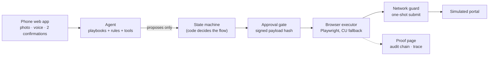

# AppealHero 申诉英雄

**Appeal a Boston parking ticket in your own language, with an AI agent whose every step you can check.**

> ⚠️ **Hackathon project** (BostonHacks 2026, Track 3: Boundless Boston).
> All filing happens on a **simulated** portal included in this repo and labeled SIMULATED on every page.
> AppealHero is not affiliated with or endorsed by the City of Boston, and it is not legal advice.
> All demo people, plates and tickets are synthetic.

## Why

To contest a Boston parking ticket, you have to:
- figure out which rule applies,
- gather evidence,
- write a formal statement in English,
- fill in a web form, all within 21 days.

For residents who are more at home in Chinese or Spanish, that friction can be enough to pay a ticket they could have contested. General-purpose chatbots can draft a letter, but they don't know which Boston rules apply, they can't file anything, and they leave no record you can verify.

## What it does

1. **Snap or look it up.** Take a photo of the ticket, or let the agent find it by plate (Massachusetts plates) or ticket number.
2. **Asks only what matters.** Each ticket type has a playbook, plus deterministic rules that cite boston.gov. For example, meters are free on Sundays and city holidays, so a Sunday meter ticket needs zero questions.
3. **Honest triage.** If there's no real ground, it says so and shows the fine and the deadline instead of inventing an excuse.
4. **Two confirmations.** You confirm the facts first. Then you approve the exact statement, shown in English with your language side by side.
5. **Files it for you.** A browser agent fills in the (simulated) portal, reads the values back, and submits exactly once.
6. **Verifiable afterwards.** You get a live timeline and screenshots, plus a proof page with the approval fingerprint, the read-back match, the confirmation number, a Playwright trace and a hash-chained audit log.

| Capability | Status |
|---|---|
| Ticket photo → structured facts (Gemini vision; offline fake mode) | ✅ v0.2 |
| Targeted questions + deterministic Boston rules with official sources | ✅ v0.2 (3 ticket types) → 🆕 5 playbooks |
| Honest "pay instead" recommendation | ✅ v0.2 |
| Approval bound to the exact form payload (HMAC-signed) | ✅ v0.2 |
| Browser filing: deterministic locators first, Gemini Computer Use per field as fallback | ✅ v0.2 (fallback tested with a fake model; not yet run with the real model) |
| Read-back gate, one-shot submit interlock, check-status-before-retry | ✅ v0.2 |
| Judge console: state machine, live screenshots, tool trace, time and cost | ✅ v0.2 |
| Light accounts with saved vehicles; "find my tickets" | 🆕 v2 |
| Separate fact confirmation and statement approval; statement edits | 🆕 v2 |
| Chinese / Spanish / English interface | 🆕 v2 |
| Proof page, hash-chained audit log, downloadable Playwright trace | 🆕 v2 |

## How it works



## What's real and what's simulated

| Real | Simulated |
|---|---|
| Gemini API calls (when a key is set) | The parking-appeal portal (`apps/mock-portal`) |
| Boston rules, fines and deadlines, cited from boston.gov (checked 2026-11-21) | Ticket data (synthetic; ticket numbers start with 9) |
| Browser automation with Playwright | The email receipt (mock inbox) |
| The safety gates and the audit trail | The demo personas |

## Safety by design

1. **The model has no submit, approve or confirm tools**, in any state.
2. **Only the user can confirm facts.** OCR, photo and model-recorded facts all start unconfirmed.
3. **Approval is a signature:** an HMAC over the exact form payload, the adapter version and an expiry. Any change to what will be typed invalidates it.
4. **Read-back gate.** Before submitting, the executor reads the portal's review page back; its values must hash to the approved payload.
5. **Network guard.** Real government hosts are hard-blocked, a single portal origin is allowed, and the submit request can pass exactly once.
6. **An unknown result is never blindly retried.** The executor checks the portal's status page first; a second attempt happens only after it proves nothing was filed.

## Quick start

```bash
# Node >= 20.12 (22 recommended)
npm install
npm run browsers          # Playwright Chromium (or set BROWSER_CHANNEL=chrome to use local Chrome)
cp .env.example .env      # add GEMINI_API_KEY for real Gemini; leave it empty for offline fake mode
npm start                 # app + API on http://localhost:4000, simulated portal on :4100
npm test                  # unit tests + end-to-end portal scenarios (fake AI, simulated portal)
npm run smoke             # with the app running: clicks through the phone flow in a real browser
```

- `npm run dev` runs everything with hot reload, with the web app on http://localhost:5173. Use `npm start` for demos.
- On a phone, the camera and microphone need HTTPS: `cloudflared tunnel --url http://localhost:4000`.

## Verified so far

- ✅ v0.2: 21 automated tests and the UI smoke test pass in fake mode. The tests cover a normal filing, the portal-redesign fallback, both timeout reconciliations, CAPTCHA stop, missing-field re-approval, honest triage and the network interlock.
- ⚠️ Not yet run with a real Gemini key: chat, vision and Computer Use.
- ⚠️ Not yet tested on real iPhone or Android devices.
- 🔲 Real Boston portal: not connected, by design.

## Documentation

| Doc | What's in it |
|---|---|
| [docs/PRODUCT_SPEC.md](docs/PRODUCT_SPEC.md) | Requirements and open decisions (Chinese) |
| [docs/ARCHITECTURE.md](docs/ARCHITECTURE.md) | v2 design: state machine, data model, APIs, agent, executor, proof (Chinese) |
| [docs/PLAYBOOKS.md](docs/PLAYBOOKS.md) | Ticket-type playbooks and rules, with official sources (Chinese) |
| [docs/TASKS.md](docs/TASKS.md) | Parallel work packages with acceptance tests (Chinese) |
| [docs/DEMO.md](docs/DEMO.md) | Demo script, checklist and Q&A (Chinese) |
| [AGENTS.md](AGENTS.md) | Rules for AI coding agents working in this repo |
| [docs/REVIEW_PROMPT.md](docs/REVIEW_PROMPT.md) | Prompt for external design reviewers (Chinese) |
| [docs/REVIEW_BUNDLE.md](docs/REVIEW_BUNDLE.md) | All docs merged into one file for external reviewers (generated) |

## Built with

TypeScript · Node.js · Fastify · Zod · React · Vite · Tailwind CSS · Playwright · Google Gemini API (`@google/genai`) · Vitest

## Team

_TBD_
