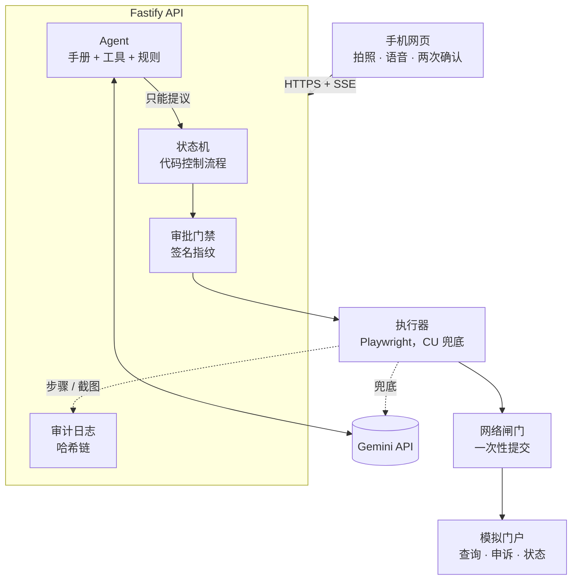
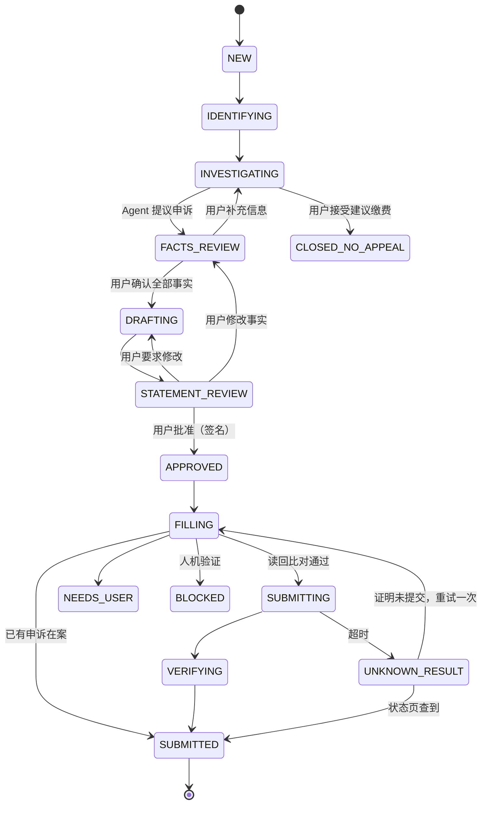
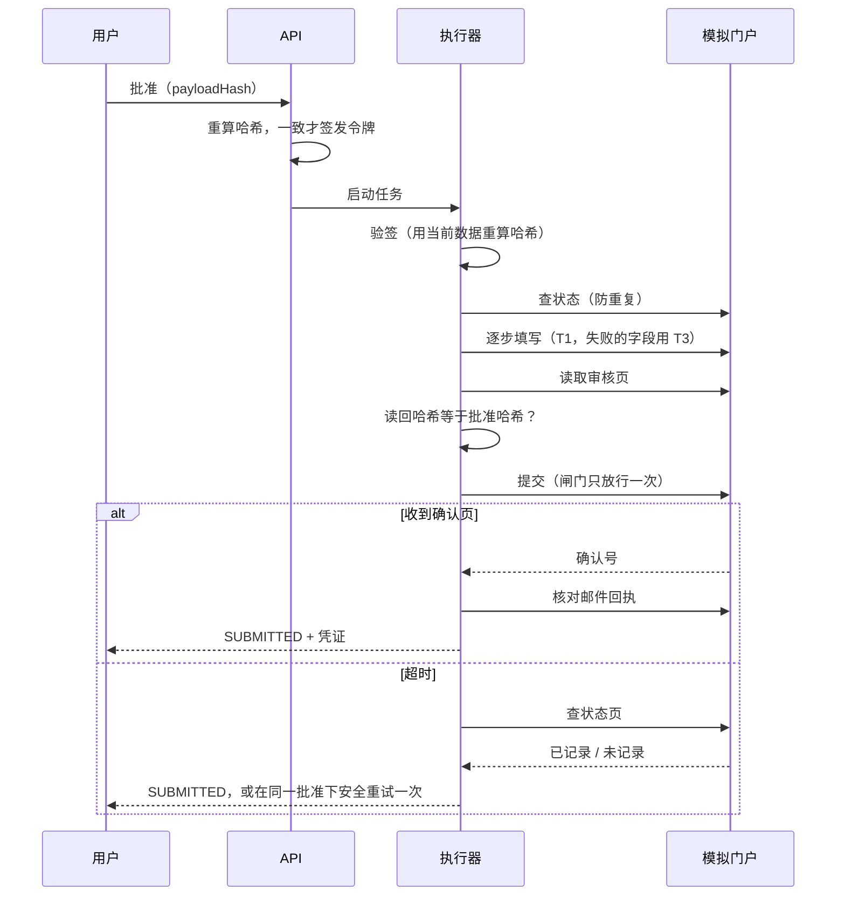

# AppealHero 申诉英雄 · 架构设计（v2 · 待评审）

> 本文是团队和所有 AI 编码代理共用的设计说明。字段级定义以 `packages/shared` 的代码为准，本文只描述结构、流程和规则。
> 状态标记：✅ v0.2 已实现并有测试 · 🔧 v0.2 已有、需按 v2 重构 · 🆕 v2 新增
> 需求见 [PRODUCT_SPEC.md](PRODUCT_SPEC.md)，罚单知识见 [PLAYBOOKS.md](PLAYBOOKS.md)，分工见 [TASKS.md](TASKS.md)，AI 编码规则见 [../AGENTS.md](../AGENTS.md)。

## 0. 总览

### 0.1 设计原则
1. **流程归代码**：状态机由代码控制，AI 只在某个状态内部做决定。
2. **特化靠结构**：手册 + 规则 + 工具，而不是一段很长的 prompt。
3. **关键动作必须由人完成**：确认事实、批准申诉信（签名）。
4. **确定性优先，AI 兜底**：执行器先用固定脚本，失败才用 Computer Use。
5. **一切可验证**：每一步留痕；提交前读回比对；结果不明先核对。
6. **没有 key 也能跑**：fake 模式跑完全流程，保证并行开发、自动化测试和演示兜底。

### 0.2 系统图



### 0.3 技术栈

| 层 | 选择 | 理由 |
|---|---|---|
| 语言 | TypeScript 全栈（Node ≥ 20.12，推荐 22） | 前后端共用类型；AI 编码工具最熟 |
| 仓库 | npm workspaces monorepo | 不需要额外工具 |
| 契约 | Zod 4（`packages/shared`） | 一份定义同时提供运行时校验、TS 类型、Gemini 工具的 JSON Schema |
| 后端 | Fastify 5（multipart、static、cookie） | 轻量、插件齐全 |
| 实时推送 | SSE，支持 Last-Event-ID 重放 | 比 WebSocket 简单；过隧道稳定；手机锁屏后能补发 |
| 存储 | 仓储接口 + JSON 文件实现（原子写入），需要时换 SQLite | 不引入 ORM；多人并行不会争数据库结构 |
| AI | `@google/genai`：`gemini-3.8-flash` 负责对话、工具调用、看图、听音；Computer Use 走 Interactions API | 一个 SDK 覆盖全部 |
| 浏览器 | Playwright | 确定性脚本优先，CU 兜底 |
| 前端 | React 19 + Vite + Tailwind 4 + React Router 7 | 手机网页打开即用；有账户页、凭证页，需要路由 |
| 多语言 | i18next + react-i18next；文案按功能拆成 JSON | AI 工具熟悉；分文件避免冲突 |
| 测试 | Vitest + Playwright + fake AI + 黄金对话测试 | 不用 key 也能验证每份手册和每个故障场景 |
| 规范 | Prettier + TS strict + AGENTS.md | 多个 AI 同时写代码时保持一致 |

不使用：React Native / Expo、Next.js、ORM、Redux、LangChain、多 Agent 框架；Mastra 视 PRODUCT_SPEC §8 决定。

## 1. 状态机 v2 🔧



### 1.1 转移与“谁能触发”

| 从 → 到 | 谁能触发 |
|---|---|
| NEW → IDENTIFYING | system |
| IDENTIFYING → INVESTIGATING | agent / system |
| INVESTIGATING → FACTS_REVIEW | agent（提议，代码校验必需事实齐全） |
| INVESTIGATING → CLOSED_NO_APPEAL | **user** |
| FACTS_REVIEW → DRAFTING | **user**（全部事实已确认） |
| FACTS_REVIEW → INVESTIGATING | user |
| DRAFTING → STATEMENT_REVIEW | system（writer 完成） |
| STATEMENT_REVIEW → DRAFTING | user（修改请求） |
| STATEMENT_REVIEW → FACTS_REVIEW | user |
| STATEMENT_REVIEW → APPROVED | **approval**（唯一入口） |
| STATEMENT_REVIEW → CLOSED_NO_APPEAL | user |
| APPROVED → FILLING | executor |
| APPROVED → STATEMENT_REVIEW | system（令牌无效） |
| FILLING → SUBMITTING / SUBMITTED / NEEDS_USER / BLOCKED / FAILED | executor |
| SUBMITTING → VERIFYING | executor |
| SUBMITTING / VERIFYING → UNKNOWN_RESULT | executor / system |
| VERIFYING → SUBMITTED | executor |
| UNKNOWN_RESULT → SUBMITTED / FILLING | executor |
| UNKNOWN_RESULT → NEEDS_USER | executor / system |
| NEEDS_USER / BLOCKED → FILLING | executor |
| NEEDS_USER → STATEMENT_REVIEW / FACTS_REVIEW / INVESTIGATING | user |
| BLOCKED → STATEMENT_REVIEW | user |
| NEEDS_USER / BLOCKED → CLOSED_NO_APPEAL | user |
| CLOSED_NO_APPEAL → INVESTIGATING | user |
| NEW / IDENTIFYING → FAILED | system |

规则：
- agent 只能触发 `IDENTIFYING → INVESTIGATING` 和 `INVESTIGATING → FACTS_REVIEW`。
- `SUBMITTED`、`FAILED` 是终态。
- 状态只能通过 `transition(ctx, caseId, to, actor, reason)` 改变；每次转移写入 `stateHistory` 和审计日志。

### 1.2 与 v0.2 的对应
- `EXTRACTED` 并入 `IDENTIFYING`。
- `READY_FOR_REVIEW` 拆成 `FACTS_REVIEW → DRAFTING → STATEMENT_REVIEW`。
- 其余状态不变。

### 1.3 崩溃恢复（服务重启时）
| 中断时的状态 | 恢复到 | 原因 |
|---|---|---|
| FILLING | NEEDS_USER | 还没提交，可以安全重跑 |
| SUBMITTING / VERIFYING | UNKNOWN_RESULT | 点击可能已发出，必须先核对 |
| APPROVED | STATEMENT_REVIEW | 任务没启动；密钥可能已轮换，需要重新批准 |
| DRAFTING | FACTS_REVIEW | 写作中断；用户再确认一次后重写 |

## 2. 数据模型 🔧

| 实体 | 关键字段 | 必须满足的规则 |
|---|---|---|
| User 🆕 | id、name、mailingAddress、email、lang、vehicles[]、persona? | 资料字段作为事实进入案件时，来源 = PROFILE，状态 = CONFIRMED |
| Vehicle 🆕 | id、plate、state、make?、color?、nickname?、isDefault | 车牌统一大写 |
| TicketInfo 🆕 | ticketNumber、plate、state、violation、issuedAt、location、fine、status、source（OCR / PORTAL_LOOKUP） | issuedAt 为带时区偏移的 ISO 时间 |
| Case 🔧 | id、userId、state、lang、ticket、playbookId、facts[]、evidence[]、messages[]、answers{}、triage、draft、approval、receipt、needsUser、metrics、stateHistory | 执行中（APPROVED…VERIFYING）不允许修改事实和申诉信 |
| Fact ✅ | id、key、label、value、provenance、status、sourceRef、note | 每个 key 一条，id 稳定；只有用户能改成 CONFIRMED |
| Evidence ✅ | id、kind（ticket_photo / evidence_photo / document / audio）、filename、mime、bytes、sha256、submitToPortal | sha256 针对实际上传到门户的字节 |
| Draft 🔧 | disputeReason、paragraphs[{text, factIds, author}]、statementEn、statementUserLang、lang、revision | agent 写的段落必须引用事实；用户亲自写的段落可以不引用 |
| ApprovalPayload ✅ | caseId、portal{id, adapterVersion}、fields{8 个门户字段}、extra{}、evidence[]、attestation | 这就是被哈希、被批准、被读回比对的对象 |
| Receipt ✅ | confirmationNumber、source（confirmation_page / status_page）、at、alreadyOnFile、emailVerified | — |
| AuditEvent 🆕 | seq、caseId、at、type、actor、data、prevHash、hash | `hash = sha256(prevHash + canonical(event))` |

**来源（provenance）**：TICKET_OCR、PORTAL_LOOKUP 🆕、USER_VOICE、USER_TEXT、PHOTO_EVIDENCE、RULE、PROFILE。
**状态（status）**：NEEDS_CONFIRMATION、CONFIRMED、USER_STATEMENT、RULE_VERIFIED、UNVERIFIABLE。
- 能进入提交内容的：CONFIRMED、RULE_VERIFIED。
- 能作为申诉理由依据的：CONFIRMED、RULE_VERIFIED、USER_STATEMENT。

**申诉理由**：METER_NOT_IN_EFFECT、PAID、SIGNAGE、VEHICLE_INFO、PERMIT_DISPLAYED 🆕、OTHER。

## 3. 接口

### 3.1 冻结的 5 个接口（路径不变；jobId === caseId）

| 接口 | v2 中的含义 |
|---|---|
| `POST /api/cases` | 创建案件。v2：照片改为**可选**（多张 `ticket` 文件）；新增可选字段 `mode`（photo / lookup / chat）、`ticketNumber`、`vehicleId`。仍兼容 v0.2 调用。返回 202 `{caseId, jobId}` |
| `POST /api/cases/:id/messages` | 用户回复（文字 / 语音 / 照片 / activeMs）。在 STATEMENT_REVIEW 状态下，消息被当作申诉信修改指令 |
| `POST /api/cases/:id/approve` | `{payloadHash, activeMs?}`。v2 只在 STATEMENT_REVIEW 有效；内容已变返回 409（附 currentHash）；未确认或缺项返回 422；重复点击幂等 |
| `GET /api/cases/:id/stream` | SSE；Last-Event-ID 重放；15 秒心跳；截图只发 URL |
| `POST /api/jobs/:id/resume` | `{action: retry / reconcile / back_to_review / provide_info, field?, value?}`。UNKNOWN_RESULT 永远先对账 |

### 3.2 v2 新增接口（WP0 定稿后冻结）

| 接口 | 作用 |
|---|---|
| `GET /api/me` · `PUT /api/me` 🆕 | 读取 / 更新资料（首次访问自动建号并下发会话 cookie） |
| `POST /api/me/vehicles` · `DELETE /api/me/vehicles/:id` 🆕 | 绑定 / 删除车辆 |
| `POST /api/session/persona` 🆕 | 切换演示身份（lin / maria / sam） |
| `GET /api/cases` · `GET /api/cases/:id` ✅ | 我的案件列表 / 单个案件视图 |
| `POST /api/cases/:id/facts/confirm` 🔧 | `{confirm[], edits[], done?}`；`done=true` 且全部确认 → FACTS_REVIEW → DRAFTING |
| `PUT /api/cases/:id/statement` 🆕 | 用户直接编辑申诉信（作者记为 user），重新校验并生成对照翻译 |
| `POST /api/cases/:id/decision` ✅ | `{choice: accept_pay / appeal_anyway}` |
| `GET /api/cases/:id/proof` 🆕 | 凭证页数据 |
| `GET /api/cases/:id/trace` 🆕 | 下载 Playwright trace.zip |
| `POST /api/cases/:id/status-check` 🆕 | 只读复查门户状态 |
| `/api/demo/{state,scenario,reset}`、`GET /api/health` ✅ | 演示开关、重置、健康检查 |

### 3.3 状态码约定
- 202：已受理，异步执行，结果通过 SSE 推送。
- 400：请求格式不对（Zod 校验失败，附 issues）。
- 404：案件不存在。
- 409：状态冲突、内容已变、正在执行。
- 422：还不能执行（附 missing、unconfirmedFactIds）。

### 3.4 SSE 事件
v0.2 已有 13 种：`case.updated`、`state.changed`、`agent.message`、`agent.tool`、`facts.updated`、`triage`、`review.ready`（申诉信审核，附批准预览和指纹）、`exec.step`、`exec.screenshot`、`needs_user`、`receipt`、`metrics`、`error`。
v2 新增 2 种：`facts.review` 🆕（事实汇总，待确认）、`lookup.results` 🆕（查询到的罚单列表）。
约定：客户端收到任何事件都重新拉取案件视图；事件只是通知。

## 4. Agent

### 4.1 模块

| 模块 | 负责什么 | 状态 |
|---|---|---|
| `agent/runtime` | 对话循环；每个阶段只开放对应工具；步数和成本上限；原样保存模型历史 | 🔧 |
| `agent/context` | 拼上下文：账户资料和车辆、案件事实、当前手册、语言要求 | 🆕 |
| `agent/playbooks` | 每种罚单一份手册（见 PLAYBOOKS.md） | 🆕 |
| `agent/tools` | 每个工具一个文件：Zod 参数 + 处理函数 + 允许的阶段 | 🔧 |
| `agent/rules` | 确定性规则，按城市分目录，每条附来源 | 🔧 |
| `agent/perception` | 罚单识别、证据分析、语音转写和翻译 | 🔧 |
| `agent/writer` | 起草、修改、翻译、校验申诉信 | 🔧 |
| `agent/policy` | 诚实检查、确认权限、隐私遮挡 | 🆕 |
| `agent/llm` | Gemini 客户端、用量与成本记录 | ✅ |
| `agent/fake` | 无 key 的确定性驱动：通用地执行手册 | 🔧 |

### 4.2 每个阶段可以用的工具

| 阶段 | 工具 |
|---|---|
| IDENTIFYING | ask_user、get_profile、lookup_tickets、select_ticket、analyze_evidence |
| INVESTIGATING | ask_user、get_profile、analyze_evidence、check_rule、record_fact、propose_outcome |
| DRAFTING | 不开放对话工具；writer 以 system 身份运行 |
| STATEMENT_REVIEW | 不开放工具；用户消息交给 writer.revise |
| 其他所有阶段 | 无 |

**提交、批准、确认事实不是工具，在任何阶段都不存在。**

### 4.3 运行时循环（伪代码）

```
onUserTurn(caseId, input):
  stage = case.state
  tools = TOOLSETS[stage]                      # 本阶段允许的工具
  history.append(user(input))
  for step in 1..MAX_STEPS (8):
    res = gemini.generateContent(system = buildContext(case), contents = history, tools)
    history.append(res.content)                # 原样追加，保留 thought signature
    if no functionCalls: say(res.text); break
    for call in functionCalls:
      args = tool.params.safeParse(call.args)  # 参数不合法 → 把错误回给模型
      out = tool.run(ctx, args)                # 处理函数内部再查权限和规则
      history.append(functionResponse(out))
    if any out.endTurn: break                  # 例如 ask_user：等用户回答
  recordUsage(); budgetCheck()                 # 超出步数或费用 → 交还用户
```

### 4.4 上下文
system 提示由代码拼装，每轮重新生成：角色与边界（不是律师、不承诺结果）→ 用户语言 → 账户资料与车辆 → 罚单与已有事实（id | key | 值 | 来源 | 状态）→ 当前手册的文字版（要问什么、哪些理由需要什么依据）→ 已上传证据列表 → 已跑过的规则结果。

### 4.5 手册
一份手册同时给两种驱动使用：
- Gemini 模式：把手册转成文字指引放进上下文，由模型决定提问顺序和措辞。
- fake 模式：直接执行手册里的 `askIf`、`holds`、`recommendPay` 函数。

接口和首批内容见 [PLAYBOOKS.md](PLAYBOOKS.md)。

### 4.6 工具

统一写法（参数 Zod 定义一次，同时生成 Gemini 的 `parametersJsonSchema`，并校验模型传入的参数）：

```ts
export const askUser = defineTool({
  name: 'ask_user',
  stages: ['IDENTIFYING', 'INVESTIGATING'],
  params: z.object({
    question: z.string(), question_en: z.string(),
    expects: z.enum(['text', 'photo', 'choice', 'yesno']),
    options: z.array(z.string()).optional(), why: z.string(),
  }),
  run: async (ctx, args) => ({ endTurn: true, result: await ctx.ask(args) }),
});
```

| 工具 | 作用 | 状态 |
|---|---|---|
| ask_user | 问一个问题（文字 / 选择 / 是否 / 拍照），结束本轮 | ✅ |
| analyze_evidence | 分析一张证据照片，提取指定信息，记为待确认事实 | ✅ |
| check_rule | 运行确定性规则；罚单相关输入从案件事实自动填入，模型不能指定日期 | ✅ |
| record_fact | 记录用户陈述（只能是 USER_STATEMENT；不能覆盖罚单字段） | ✅ |
| propose_outcome | 结束调查：APPEAL（理由 + 事实引用）→ FACTS_REVIEW；或 PAY → 诚实建议 | 🔧 v0.2 直接起草，v2 改为先进入事实确认 |
| get_profile | 读取账户资料和车辆 | 🆕 |
| lookup_tickets | 在门户只读查询（车牌 + 州，或罚单号） | 🆕 |
| select_ticket | 用户选定罚单后写入案件（来源 PORTAL_LOOKUP） | 🆕 |

### 4.7 规则库

| 规则 | 作用 | 来源 | 状态 |
|---|---|---|---|
| meter_hours_in_effect | 计时器周一至周六 8:00–20:00 运营 | boston.gov/contact/parking-clerk | ✅ 已核对 |
| meter_free_day | 周日和市政假日计时器免费 | parking-ticket-faqs；311 假日表 | ✅ 已核对 |
| receipt_covers_ticket | 付款时段是否覆盖罚单时间 | 计算 | ✅ |
| appeal_deadline | 21 天内缴费或申诉 | parking-ticket-faqs | ✅ 已核对 |
| fine_amount | 罚款与滞纳金 | parking-ticket-fines-and-codes | ✅ 已核对（5 种手册的金额与 v0.2 一致） |
| video_hearing_eligibility | 视频听证资格 | how-appeal-parking-ticket | ✅ 已核对 |
| online_plate_lookup | 只有 MA 车牌能在线按车牌查 | how-pay-parking-ticket | ✅ 已核对 |
| vehicle_matches_account | 罚单车辆信息与账户车辆比对 | 计算 | 🆕 |
| time_within_posted_hours | 罚单时间是否在路牌时段内（路牌文字由感知模块提取） | 计算 | 🆕 |
| posted_schedule_applies | 街道清扫：开票时间是否符合路牌上的周次、时段、月份（以现场路牌为准） | street-cleaning-boston | 🆕 ✅ 已核对 |
| permit_area_match | 许可街区、车牌与路牌是否一致 | 交通规则 Art. IV §1(21)、§15(6) | 🆕 ✅ 已核对 |
| hydrant_distance | 消防栓 10 英尺以内禁停 | 交通规则 Art. IV §1(6) | 🆕 ✅ 已核对 |
| temp_sign_notice | 临时禁停牌须提前设置：住宅区 48 小时、商业区 24 小时 | 交通规则 Art. IX(4) | 🆕 ✅ 已核对 |

所有规则返回 `{result, detail, source}`，结果写成 RULE_VERIFIED 事实并附来源。未核实的规则标 `verified: false`，不能用来自动生成申诉理由。
“计时器坏了”不是豁免理由（交通规则 Art. IV §4(6)），只作为诚实提示，详见 PLAYBOOKS §4.1。交通规则条款号是通过摘要工具读取的，实现前要对照 PDF 原文复核。

### 4.8 感知
- `extractTicket`：1–3 张照片 + 可选语音 / 文字 → 结构化罚单 + 用户陈述（原文 + 英文翻译）；结构化输出；置信度低就请用户重拍。✅
- `analyzeEvidence`：按要求提取付款截止时间、路牌文字与可见度、车辆描述、许可贴纸。✅（v2 增加路牌时段、许可）
- `transcribe`：语音 → 原文 + 英文。前端统一转成 16 kHz 单声道 WAV 上传（Gemini 文档列出的格式不含 webm/mp4）。✅
- fake 模式：合成测试图在 PNG 文本块里写入真实值，fake 感知直接读取。🆕

### 4.9 写作
- `draft`：按理由和事实生成 3–5 段英文；每段引用事实 id；不超过门户字段上限；同时生成用户语言对照。✅
- `revise`：按用户指令修改；指令里出现的新事实先记为 USER_STATEMENT；保留用户亲自写的段落；revision 加一。🆕
- `validate`：引用的事实必须存在且可作为依据；长度不超限；不出现承诺或威胁性措辞；校验失败退回模板。✅
- 申诉信任何变化都会改变批准指纹，旧批准自动失效。

### 4.10 策略
- **诚实检查** 🆕：用户说法与证据或规则结果矛盾时（例如说“没有路牌”，照片里路牌清晰），Agent 必须指出，且不得把该说法写进申诉信。
- **确认权限** ✅：只有确认接口能把事实改成 CONFIRMED。
- **隐私** 🔧：截图可遮挡 `data-pii` 字段；日志不记录完整车牌和邮箱；可删除证据。

### 4.11 Gemini 接入要点
- 模型：`gemini-3.8-flash`（对话、工具调用、多模态、Computer Use）。模型名通过环境变量配置。
- Gemini 3 函数调用必须回传 thought signature：历史里原样保存模型返回的 content，不要手工重建 functionCall。
- 结构化输出使用 `responseMimeType: application/json` + `responseJsonSchema`。
- 每次调用记录 `usageMetadata`，算进案件成本。
- 免费层的输入输出会被用于改进 Google 产品；处理真实用户数据时使用付费层。

## 5. 门户与执行器

### 5.1 适配器接口 🆕

```ts
interface PortalAdapter {
  id: string;            // 'mock-boston'
  version: string;       // 参与批准指纹；适配器一改，旧批准失效
  origin: string;        // 网络闸门只放行这个来源
  submitPath: RegExp;    // 一次性闸门拦截的提交请求
  lookup(page, q: { plate?: string; state?: string; ticketNumber?: string }): Promise<TicketInfo[]>;
  fillToReview(page, payload: ApprovalPayload, files: UploadFile[], hooks: SessionHooks): Promise<ReviewReadback>;
  submit(page, timeoutMs: number): Promise<{ kind: 'confirmed'; confirmationNumber: string } | { kind: 'unknown'; detail: string }>;
  checkStatus(page, ticketNumber: string): Promise<{ found: boolean; confirmationNumber?: string }>;
  checkInbox?(page, email: string, confirmationNumber: string): Promise<boolean>;
}
```
v0.2 的 `PortalSession` 已实现 fillToReview / submit / checkStatus / checkInbox 的逻辑 ✅，v2 把它整理成 `mockBoston` 适配器，并新增 lookup。

### 5.2 逐字段的填写阶梯 ✅

| 层 | 做法 | 成本 |
|---|---|---|
| T1 | 按标签定位（`getByLabel`，精确匹配） | 0 |
| T1b | 下拉框：找唯一包含目标选项值的 `<select>` | 0 |
| T2 | 按 placeholder / aria-label 关键词启发式定位（默认关闭） | 0 |
| T3 | Computer Use，只修 T1/T2 失败的那一个字段 | 几美分 |
| FILE | 文件上传永远用确定性代码（CU 无法操作原生文件选择框） | 0 |

默认 `EXEC_TIERS=T1,T3`。每填一个字段都从页面读回值进行比对。

### 5.3 Computer Use 兜底 ✅（真实模型待实测）
- 通过 Interactions API 调用：每执行完一个动作，回传当前 URL 和 PNG 截图，用 `previous_interaction_id` 续接。
- 坐标为 0–999 归一化值；视口固定 1280×800，deviceScaleFactor 为 1。
- 动作限制：只能点击输入框和输入文字；不能点按钮或链接；不能按 Enter；不能导航；`require_confirmation` 永不自动确认，直接交还用户。
- 输入完成后读取当前焦点元素的值进行比对，不盲信模型。
- fake 模式使用 FakeCuModel：从 DOM 找到字段位置，但走同一套坐标、策略和比对代码；所有事件标注 FAKE。

### 5.4 四道闸门 + 签名
1. **工具不可见**：模型在任何阶段都拿不到提交、批准、确认类工具。✅
2. **只有用户能确认事实**；有未确认事实时不能写作，也不能批准。✅
3. **读回门禁**：提交前读取门户审核页的值，组成同样结构的载荷并计算哈希，必须等于批准时的哈希。✅
4. **网络层一次性闸门**：硬拦真实政府域名；只放行一个来源；提交请求只有在门禁放行后才能通过一次。✅

**签名令牌**：`HMAC(secret, caseId | payloadHash | adapterVersion | exp)`。执行前用当前数据重算哈希再验签。同一批准最多两次提交尝试，第二次必须在状态页证明第一次没有被记录之后。✅

### 5.5 提交时序



### 5.6 结果不明时的对账 ✅
超时 → UNKNOWN_RESULT → 打开新的浏览器上下文（闸门不放行任何提交）查状态页：
- 查到申诉 → SUBMITTED（回执来源 status_page）。
- 证明没有提交，且尝试次数 < 2 → 回到 FILLING 重试一次。
- 否则 → NEEDS_USER，并给出手动提交包。

### 5.7 模拟门户与故障场景

| 场景 | 期望结果 | 状态 |
|---|---|---|
| normal | SUBMITTED，确认页回执，邮件已核对 | ✅ |
| redesign（标签消失 + 弹窗） | 弹窗被确定性关闭；文本字段由 T3 填写；SUBMITTED | ✅（fake CU） |
| submit_timeout_after_record | UNKNOWN_RESULT → 状态页查到 → SUBMITTED，无重复 | ✅ |
| submit_timeout_before_record | UNKNOWN_RESULT → 未记录 → 重试一次 → SUBMITTED，仅一条申诉 | ✅ |
| captcha | BLOCKED，零提交，给出手动提交包 | ✅ |
| missing_field | NEEDS_USER → 用户补充 → 旧批准被拒 → 重新批准 → SUBMITTED | ✅ |
| 查询：MA 车牌 / 外州车牌 / 查不到 / 多张 | 列出罚单 / 要求罚单号 / 如实告知 / 让用户选 | 🆕 |
| session_expired、upload_rejected、页面藏有提示注入文字 | NEEDS_USER 或安全重跑；注入文字不改变任何行为 | 🆕 |
| `/calibrate` 坐标校准页 | 用真实 CU 点击已知靶点，验证坐标换算 | 🆕 |

模拟门户的字段来自 boston.gov 公布的申诉所需信息（姓名、邮寄地址、争议性质、车牌与州、罚单号、证据）。字段一致，外观刻意不同，页面顶部红条标注 SIMULATED，并设置 noindex。

## 6. 验证与审计

### 6.1 实时可见 ✅
手机端显示步骤时间线和最新截图；桌面控制台显示状态机、浏览器画面、工具调用轨迹、耗时与成本。

### 6.2 凭证页 🆕
- 批准指纹和被批准的完整内容（英文申诉信 + 母语对照）。
- 读回比对结果（门户显示的值的哈希 = 批准哈希）。
- 每一步的时间戳和截图。
- 确认号、回执来源、邮件回执核对结果。
- “再查一次状态”按钮。
- 下载 Playwright trace（可在 trace.playwright.dev 完整回放）。
- 审计哈希链的最新哈希。

### 6.3 哈希链审计日志 🆕
每个事件（状态转移、工具调用、执行步骤、批准、回执）追加一条：`hash_n = sha256(hash_{n-1} + canonical(event_n))`。导出 JSON 后可以用 `scripts/verify-audit.mjs` 重算，任何改动都会导致校验失败。

## 7. 账户与多语言

### 7.1 轻账户 🆕（默认，待确认）
- 首次访问 `GET /api/me` 自动建号，下发 httpOnly 会话 cookie。
- 资料与车辆存服务器；新建案件时自动作为 PROFILE 事实（已确认）带入。
- 演示身份：`lin`（zh，NY `KDT4821`）、`maria`（es，MA `8KDW21`）、`sam`（en，MA `5NB302`），分别对应三张合成罚单。
- 不做密码、OAuth、找回账户。

### 7.2 多语言 🆕
- 界面：`apps/web/src/i18n/locales/{zh,es,en}/{common,onboarding,intake,chat,review,filing,proof,account}.json`；评委控制台只用英文。
- 语言选择：首次打开选择，保存到账户；可随时切换。
- Agent：以用户语言对话；每个问题同时保存英文版（`question_en`），用于审计。
- 申诉信：英文正文（提交用）+ 用户语言对照（只供核对）。
- 语音：前端录音转成 WAV 上传；也可以直接用手机键盘的语音输入。
- 可选：用浏览器的 `speechSynthesis` 朗读 Agent 消息。

## 8. 存储
- 仓储接口：`UserRepo`、`CaseRepo`、`AuditRepo`；v2 使用 JSON 文件实现（防抖 + 先写临时文件再 rename），需要时可换 SQLite，调用方不用改。
- 上传文件：`data/uploads/<caseId>/`；截图：`data/shots/<caseId>/`；trace：`data/traces/<caseId>/`。
- 启动时执行 §1.3 的崩溃恢复。

## 9. 测试策略

| 层 | 内容 | 运行方式 |
|---|---|---|
| 单元 | 状态机转移和 actor 规则、canonical JSON、令牌、规则函数、writer 校验 | `npm test` |
| 黄金对话 🆕 | 每份手册 ≥ 3 条脚本（理想申诉、建议缴费、证据矛盾），至少一条用中文或西语 | `npm test`（fake 模式） |
| 端到端 | §5.7 全部场景；判定依据是模拟门户自己记录的数据：每张罚单 ≤ 1 条申诉，提交内容 = 批准内容 | `npm test`（本机 Chrome 或 Playwright Chromium） |
| UI 冒烟 | 手机视口走完全流程（中文 + 西语），桌面控制台渲染 | `npm run smoke` |
| 真实 Gemini 冒烟 🆕 | 用真 key 跑一个案件 + 一次 CU 字段修复 | `npm run smoke:gemini`（手动，不进 CI） |

## 10. 目录结构 v2 与迁移

```
packages/shared/src/      states · schemas · events · api · portal · demo · canonical · playbook · tool · adapter
apps/server/src/
  core/                   fsm · hub · config · errors · store/{users,cases,audit}
  users/                  资料 · 车辆 · 演示身份 · 会话
  agent/{runtime,context,playbooks,tools,rules,perception,writer,policy,llm,fake}/
  approval/               payload · token · preview
  portal/{adapters/mockBoston,browser,cu,runner}/
  audit/                  chain · proof
  routes/                 cases · jobs · users · proof · demo · uploads
apps/mock-portal/src/     申诉流程 · 查询页 · 状态页 · 收件箱 · 校准页 · /admin
apps/web/src/
  app/                    路由 · 全局 provider（i18n、会话）
  features/{onboarding,intake,chat,factsReview,statementReview,filing,proof,account}/
  console/                评委控制台
  i18n/locales/{zh,es,en}/
  lib/                    api 客户端 · SSE hook · 图片压缩 · 录音转 WAV
scripts/                  ui-smoke · make_ticket · verify-audit
```

| v0.2 文件 | v2 位置 | 处理 |
|---|---|---|
| `packages/shared/src/{states,schemas,events,api}.ts` | 同 | 🔧 状态 v2、新实体、新事件、新接口 |
| `packages/shared/src/{portal,demo,canonical}.ts` | 同 | ✅ 保留（portal 增加 PERMIT_DISPLAYED） |
| — | `packages/shared/src/{playbook,tool,adapter}.ts` | 🆕 |
| `apps/server/src/{fsm,hub,config,store}.ts` | `core/` | 🔧 store 拆成三个仓储 |
| `apps/server/src/{ctx,types,util}.ts` | `core/` | ✅ 搬家 |
| `apps/server/src/agent/index.ts` | `agent/runtime/` | 🔧 |
| `apps/server/src/approval.ts` | `approval/` | ✅ 拆分 |
| `apps/server/src/agent/investigate.ts` | `agent/runtime/` + `agent/fake/` | 🔧 fake 改为通用执行手册 |
| `apps/server/src/agent/tools.ts` | `agent/tools/*.ts` + registry | 🔧 |
| `apps/server/src/agent/rules.ts` | `agent/rules/boston/*.ts` | 🔧 |
| `apps/server/src/agent/{extract,draft,facts,llm}.ts` | `perception/`、`writer/`、`policy/`、`llm/` | ✅ / 🔧 |
| `apps/server/src/executor/{adapter,runner}.ts` | `portal/adapters/mockBoston/`、`portal/runner/` | 🔧 |
| `apps/server/src/executor/{guard,browser,shots,cu}.ts` | `portal/browser/`、`portal/cu/` | ✅ 搬家，增加 trace |
| `apps/server/src/routes/*` | `routes/*` | 🔧 增加 users、proof |
| `apps/web/src/components/*` | `apps/web/src/features/*`、`console/` | 🔧 加路由和 i18n |
| `apps/web/src/{App.tsx,api.ts,hooks.ts}`、`lib/media.ts` | `apps/web/src/app/`、`lib/` | 🔧 |
| `apps/mock-portal/src/*` | 同 | 🔧 增加查询页、校准页、更多合成罚单 |

## 11. 已验证 / 待验证

**已验证（2026-11-21 读取官方页面或在本仓库实测）**
- 官方页面：申诉渠道与在线申诉的即时邮件回执；21 天期限；逾期仍可申诉但加收滞纳金；决定一般在 7–10 个工作日内邮寄；计时器周一至周六 8:00–20:00、周日和市政假日免费；只有 MA 车牌可在线按车牌查询；视频听证资格；RMV 不收停车罚单。
- 手册相关（详见 PLAYBOOKS §8）：5 种罚单的罚款与滞纳金；消防栓 10 英尺；故障计时器不是豁免；街道清扫季节与“以现场路牌为准”；居民许可的展示位置与区域规则；临时禁停牌须提前 48 / 24 小时设置。
- 本仓库：v0.2 的 21 个自动化测试 + UI 冒烟测试全部通过（fake 模式，本机 Chrome）。

**待验证**
- 真实 Gemini 调用（对话、看图、Computer Use）尚未用真 key 运行；CU 坐标换算需在校准页实测。
- 真机（iPhone / Android）上的拍照、录音、SSE 断线重连。
- 手册中仍待核实的事项：街道清扫在市政假日是否照常执法、访客许可细则、被盗 / 出售 / 故障车辆所需材料等（见 PLAYBOOKS §9）；交通规则条款号需对照 PDF 原文复核。
- 真实门户的表单字段、验证码、供应商条款（不在比赛中接入）。
- Devpost 视频时长：官方页写 1 分钟，第三方汇总写 30 秒，以主办方为准。

## 12. 已知坑（v0.2 已处理）
- 新版 Chrome 的 `scrollIntoView()` 返回 Promise：`useEffect` 里必须用花括号，否则 React 报 `destroy is not a function`。
- Playwright 的 `addLocatorHandler` 只在 locator 操作时触发，不管 CU 的鼠标事件，所以弹窗在每一步开始时显式关闭。
- `@fastify/static` 要用 `wildcard: true`，否则重新构建后的新资源文件会被 SPA 回退成 HTML。
- `tsx watch` 一保存文件就重启服务：演示时用 `npm start`。
- iPhone 用 http 局域网地址打开时麦克风不可用：必须走 HTTPS 隧道；Vite 需要 `allowedHosts: true`。
- 官方 CU 示例用 Meta+A 清空输入框（只适用于 macOS），代码里改用 `ControlOrMeta+A`。
